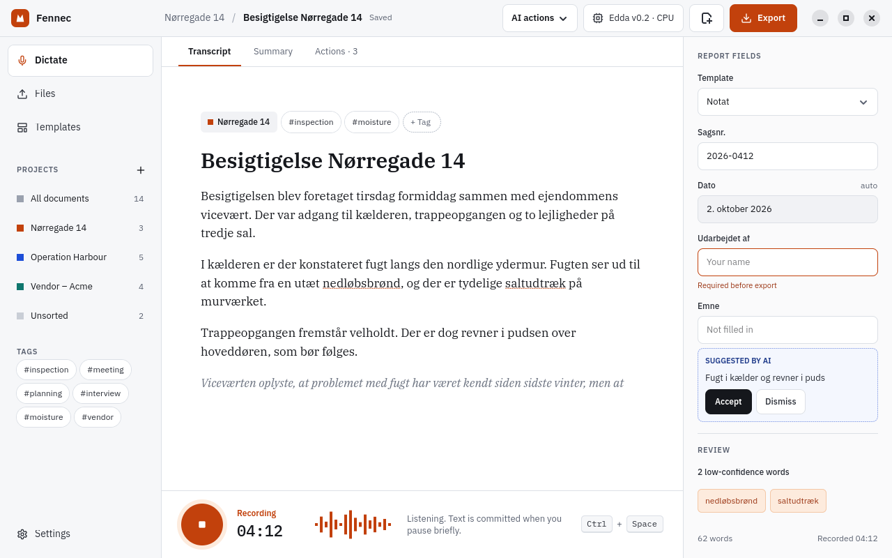
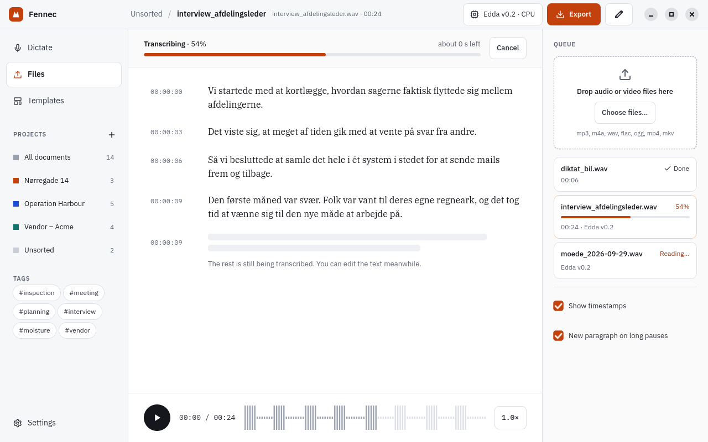
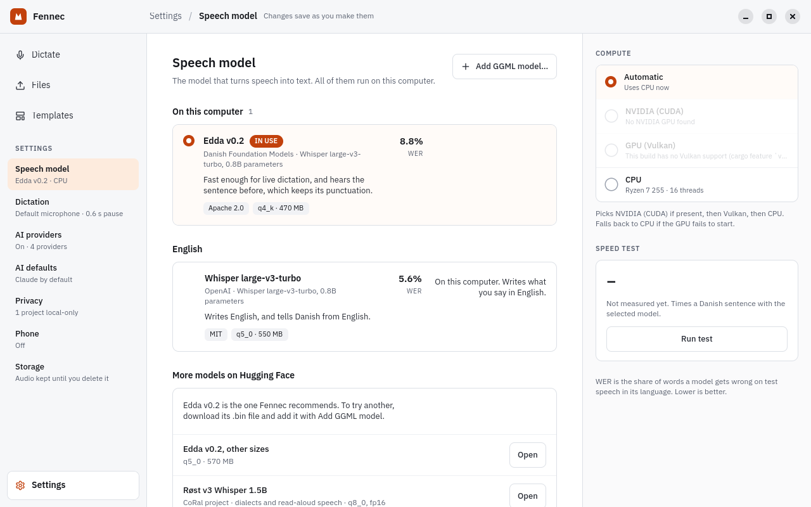
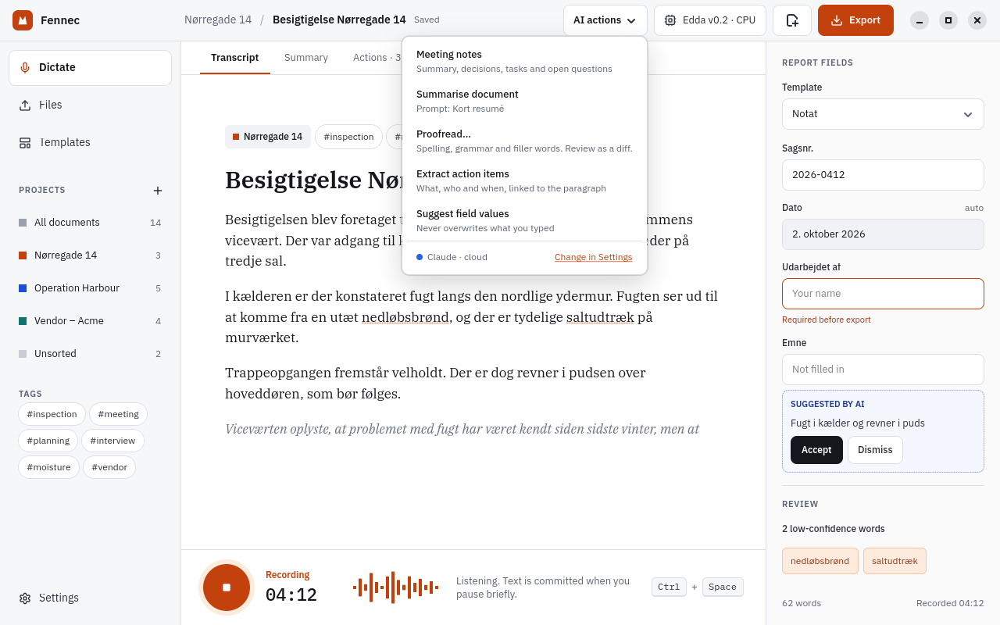
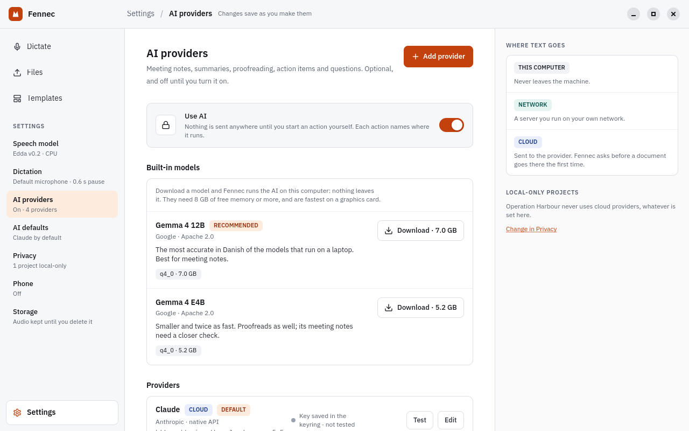
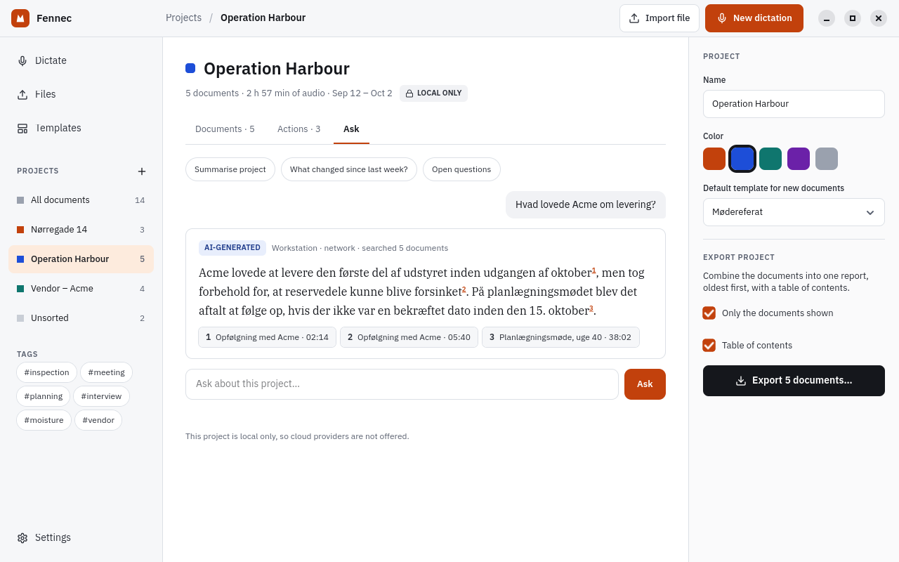
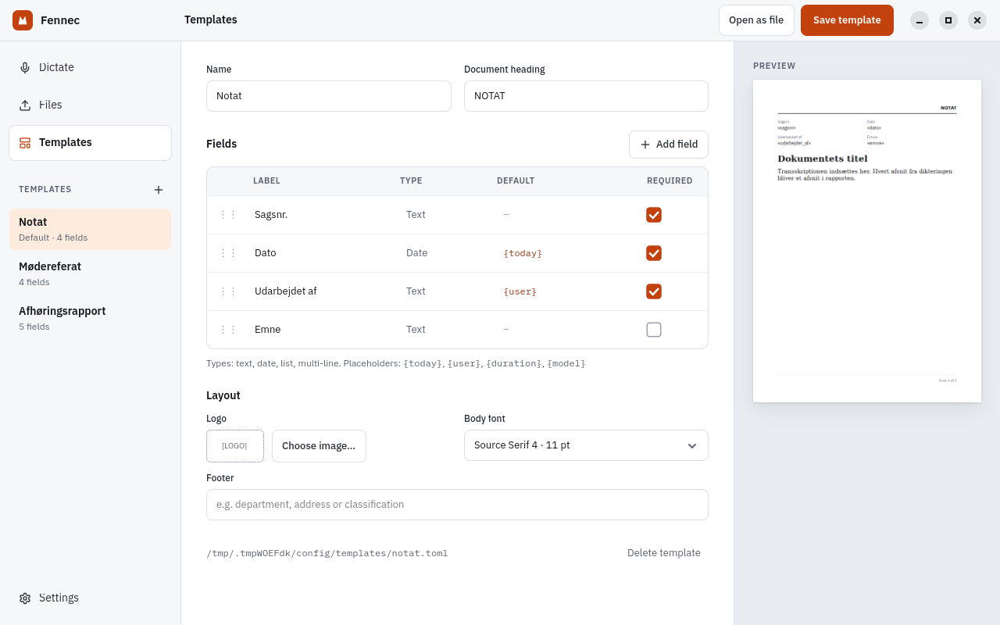
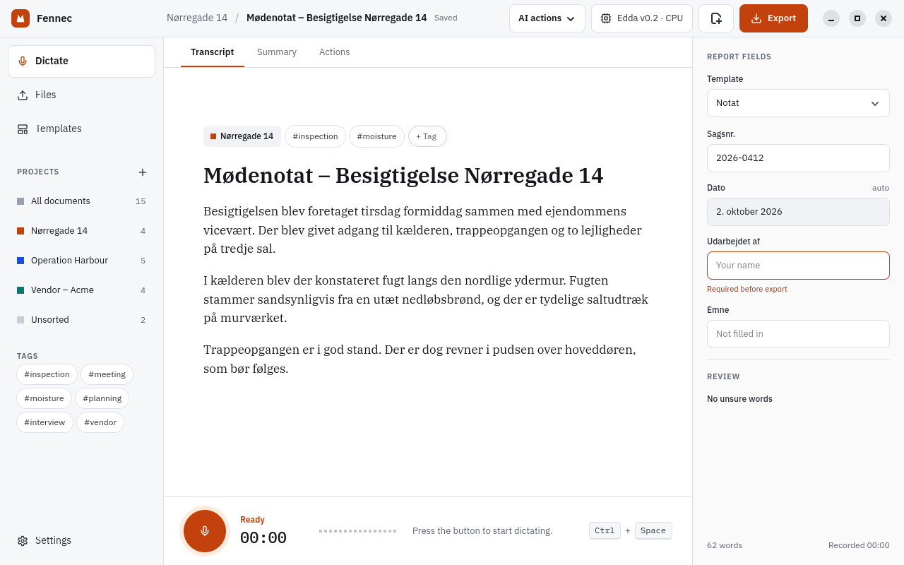
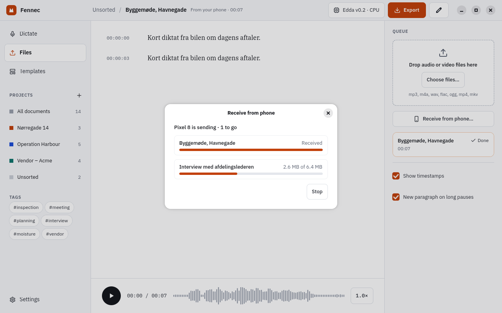
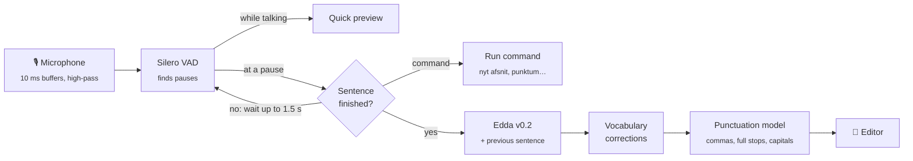

<div align="center">


# Fennec

**Danish and English dictation and transcription that runs entirely on your own computer.**

Speak, and the text appears with commas, full stops and capitals.<br>
No audio leaves the machine, and no account or internet connection is needed once the models are downloaded.

[](Cargo.toml)




</div>

---

## Why Fennec

Danish speech recognition has become very good, but most tools that use it send
your voice to a server. Fennec puts the best open Danish models behind a fast
native desktop app, so meeting notes, reports and interviews stay on your own
disk.

- 🎙️ **Live dictation**: text appears a moment after each pause, and a
  short preview shows while you are still talking.
- ✍️ **Real punctuation**: a Danish punctuation model adds commas, full stops
  and capitals. Sentence ends rose from F1 0.61 to 0.81, with no words
  changed.
- 🇬🇧 **English too**: Fennec hears whether you speak Danish or English and
  uses the right model for each dictation or file, or you choose the
  language yourself.
- 🗣️ **Spoken commands**: *nyt afsnit*, *ny linje*, *punktum*, *komma*,
  *spørgsmålstegn*, *slet sidste sætning*, *stop optagelse* and more, and
  their English counterparts (*new paragraph*, *full stop*…). You can add
  your own phrases.
- 📂 **File transcription**: audio or video in, timestamped paragraphs out,
  with a player to check every passage.
- 📚 **Learns your words**: a vocabulary list fixes names and terms the model
  mishears, and Fennec offers to remember a word whenever you correct it
  in the editor.
- 🧾 **Report templates and export**: header fields plus body, exported to
  TXT, DOCX or PDF, one document or a whole project at a time.
- 🗂️ **Projects and tags**: group documents, search across them and export
  them together.
- 🤖 **Optional AI** (off by default): meeting notes (summary, decisions,
  tasks with owners and dates, open questions), a rewrite of a dictation as a
  professional meeting note, summaries, proofreading shown as a diff that
  fills in part by part, action items and questions answered from a project
  with sources.
  Works with a built-in model that runs on this computer (Gemma 4, one-click
  download), Claude, ChatGPT, or your own server (Ollama, llama.cpp,
  LM Studio, vLLM).
- 📱 **Record on your phone**: Fennec Recorder for Android records meetings.
  To send them, choose **Receive from phone** in Fennec and scan the code;
  the audio goes straight to Fennec over your own network (or a USB cable)
  and is transcribed like any file. See [`android/`](android/README.md).

The interface is in English; transcripts are in Danish or English, and AI
answers in the transcript's language unless you pick one. On a small screen
the sidebar and side panels fold away behind buttons in the header.

## Screenshots

<table>
  <tr>
    <td></td>
    <td></td>
  </tr>
  <tr>
    <td align="center"><sub>Transcribe audio and video files</sub></td>
    <td align="center"><sub>Danish and English speech models</sub></td>
  </tr>
  <tr>
    <td></td>
    <td></td>
  </tr>
  <tr>
    <td align="center"><sub>Meeting notes, summaries and proofreading</sub></td>
    <td align="center"><sub>Built-in AI that runs on this computer</sub></td>
  </tr>
  <tr>
    <td></td>
    <td></td>
  </tr>
  <tr>
    <td align="center"><sub>Ask a project, with sources</sub></td>
    <td align="center"><sub>Report templates with a live preview</sub></td>
  </tr>
  <tr>
    <td></td>
    <td></td>
  </tr>
  <tr>
    <td align="center"><sub>Rewrite a dictation as a meeting note</sub></td>
    <td align="center"><sub>Send recordings from your phone with a QR code</sub></td>
  </tr>
</table>

## Quick start

The easiest way in is the ready-made package from
[Releases](https://github.com/AngelFreak/Fennec/releases) (Ubuntu 24.04 or
newer). It uses the GPU through Vulkan when there is one, and the CPU
otherwise.

```sh
sudo apt install ./fennec_*.deb
```

To build it yourself, Fennec needs Linux with GTK 4.14+ and libadwaita 1.5+
(Ubuntu 24.04 or newer) and Rust 1.88+.

```sh
sudo apt install libgtk-4-dev libadwaita-1-dev libasound2-dev cmake clang
git clone https://github.com/AngelFreak/Fennec && cd Fennec

make install FEATURES=vulkan   # AMD / Intel / NVIDIA GPU (needs glslc and libvulkan-dev)
make install FEATURES=cuda     # NVIDIA via CUDA
make install                   # CPU only
```

`make install` puts Fennec in `~/.local` and needs no root. For a Debian
package, run `make deb FEATURES=vulkan` and then
`sudo apt install ./target/debian/fennec_*.deb`.

On first launch, a bar offers a **single download** of everything dictation
needs: the speech model, the voice detector and the punctuation model, plus
the English model if you may speak English, up to about 1.6 GB together.
Nothing else needs to be set up. The built-in AI models are optional and
downloaded separately (see [Built-in AI](#built-in-ai)).

<details>
<summary>Optional extras and building without root</summary>

- `ffmpeg`, for video and audio formats Fennec cannot decode itself.
- GStreamer good plugins, for playback in Files.
- A Secret Service keyring (GNOME Keyring or KWallet), to store AI API keys.

Without root, `glslc` can be unpacked from Ubuntu's packages:
`apt-get download glslc libshaderc1`, `dpkg -x` each into a folder, then put
its `usr/bin` on `PATH` and its `usr/lib/x86_64-linux-gnu` on
`LD_LIBRARY_PATH`.

</details>

## Speed

Use a GPU build for live dictation. On a laptop with a Ryzen 5 7640U and its
integrated Radeon 760M:

| | Vulkan (760M) | CPU only |
|---|---|---|
| Edda, real-time factor | **0.19×** | 1.9× |
| Start dictating | ~0.4 s to the first audio | |
| Live dictation | ✅ keeps up | ❌ falls behind |

File transcription works on either. **Settings → Speech model** shows which
backends this build and computer can use, and **Run speed test** times a
Danish sentence on your machine. If the GPU fails to start, Fennec falls back
to the CPU.

## Speech models

| Model | Publisher | Licence | Size | WER |
|---|---|---|---|---|
| **Edda v0.2** (Danish) | Danish Foundation Models | Apache 2.0 | ~470 MB | 8.8 % |
| **Whisper large-v3-turbo** (English) | OpenAI | MIT | ~550 MB | 5.6 % |

Fennec offers one Danish model, the one it recommends. **Settings → Speech
model** links to others on Hugging Face (Edda v0.2 in other sizes, Røst v3,
stock Whisper); download a GGML `.bin` and add it with **Add GGML model…**.
Models installed from earlier versions stay listed and keep working.

WER is the word error rate shown in Fennec's model list: for Edda the mean on
the [Danish ASR leaderboard](https://huggingface.co/spaces/RyeAI/danish-asr-leaderboard),
for Whisper on 100 English FLEURS clips.
On held-out Danish FLEURS sentences here, Edda v0.2 scored 6.2 %.

**English** always uses OpenAI's Whisper large-v3-turbo, downloaded when
English may be spoken (from the Dictate page's setup offer, or Settings →
Speech model → English). On 100 English FLEURS clips it scored
5.6 % WER, level with NVIDIA's Parakeet TDT v3 (5.5 %) but with better
punctuation, and it told Danish from English in all 100 test clips. In
*Detect automatically* (the default) it listens to the first words of each
dictation or file and keeps that language to the end. The Danish models
cannot write English (Edda: 56 % WER), and the punctuation model is Danish,
so English text comes punctuated by Whisper itself.

**Edda v0.2** is a fine-tuned Whisper large-v3-turbo. It reads the previous
sentence as context, which keeps its punctuation consistent across pauses.
Fennec downloads a ready-converted GGML file
([`tec-7/edda-v0.2-ggml`](https://huggingface.co/tec-7/edda-v0.2-ggml)), so
installing it needs no Python. It is quantised to q4_k, which is as accurate
as q5_0 on 300 Danish FLEURS clips (WER 8.3 % vs 8.5 %, CER 3.1 % both),
100 MB smaller and about 1.5× faster on the CPU. Installs that have the
earlier q5_0 file keep using it, and Settings offers the update.

You can also add any whisper.cpp GGML file with **Add GGML model…**.

<details>
<summary>Models from earlier versions</summary>

Earlier versions also offered Edda v0.1, Røst v3, Hviske v3 conversation and
Hviske v6. Where they are installed, Fennec lists them as custom models and
runs them as before. Hviske v6 is not a Whisper model that whisper.cpp can run
(it pairs a Whisper encoder with a Qwen3 decoder), so Fennec runs it in a
small Python helper, which needs `torch` and `transformers`. Hviske's licences
do not allow commercial use.

</details>

## Built-in AI

**Settings → AI providers → Built-in models** downloads a language model
that Fennec runs itself with [llama.cpp](https://github.com/ggml-org/llama.cpp)'s
server, which comes in the package. It starts on 127.0.0.1 only when an AI
job runs and stops after ten idle minutes, so the model's memory is only in
use while it works. Nothing leaves the computer.

| Model | Licence | Download | Best for |
|---|---|---|---|
| **Gemma 4 12B** (recommended) | Apache 2.0 | 7.0 GB | meeting notes, Danish |
| Gemma 4 E4B | Apache 2.0 | 5.2 GB | proofreading, smaller computers |

Both are Google's quantisation-aware q4_0 builds. Gemma 4 12B is the best
open model of its size on the [EuroEval](https://euroeval.com) Danish
leaderboard (October 2026); Danish fine-tunes of it scored no better. On a
Radeon 780M laptop GPU, notes for a 600-word Danish meeting take about
100 s with either model, and proofreading it 50 s (E4B) or 2 min (12B). In
tests on made-up Danish and English meetings, the 12B got owners, decisions
and deadlines right where the E4B sometimes slipped.

**Meeting notes** fill the Summary tab with a summary, the topics, the
decisions, the tasks (who and by when) and open questions, and put the tasks
in the Actions tab, each linked to the paragraph it comes from. The
instructions name what small models got wrong without them: they invented
who said what, filed tasks as decisions and counted weekdays wrong, so the
model is told never to guess a speaker and is given a calendar of the coming
weeks. **Proofread** fixes spelling, grammar, Danish commas, capitals and
misheard words and removes filler words, changing as little as possible.
English transcripts get English instructions and answers.

`vLLM` is in **Add provider** for a server you run yourself (port 8000); it
needs an NVIDIA GPU and cannot be built into Fennec.

## How dictation works



- **Sentences survive a pause.** At each pause a quick pass checks whether the
  sentence has ended. If it hasn't, Fennec waits a little longer so a thought
  isn't cut in half. In a test with pauses in the middle of sentences, this
  cut word errors from 13.9 % to 7.7 %.
- **Punctuation only adds.** The punctuation model (Alvenir's Danish BERT, run
  in Rust with [candle](https://github.com/huggingface/candle)) inserts marks
  and capitals but never changes or removes a word, so a spoken *komma* always
  stays.
- **The UI never waits on the model.** Speech runs on its own thread with
  priorities. The level meter runs on the display's frame clock, and the
  microphone opens in about 50 ms.

## Privacy

- Audio is processed on this computer and is never uploaded.
- Fennec listens for a phone only while the **Receive from phone** code is
  shown. Recordings travel encrypted from the phone to this computer only;
  each code works once, for the phone that scans it, and nothing stays
  paired.
- AI stays off until you switch it on in **Settings → AI providers**, and
  nothing is sent until you start an action yourself.
- The first time a document or project goes to a **cloud** provider, Fennec
  asks and names the destination. Projects marked **Local only** never go to
  the cloud.
- API keys are stored in the desktop keyring, not in a settings file.
- Every AI result is labelled with the provider and model that wrote it, and
  proofreading never changes text until you accept it.

## Where things live

| What | Where |
|---|---|
| Settings | `~/.config/fennec/settings.toml` |
| Templates | `~/.config/fennec/templates/*.toml` |
| Documents (SQLite) | `~/.local/share/fennec/fennec.db` |
| Models | `~/.local/share/fennec/models/` (built-in AI models in `ai/`) |
| Dictation and phone audio | `~/.local/share/fennec/audio/` |
| Certificate phones check | `~/.local/share/fennec/sync/` |
| Exports | `~/Documents/Fennec/` |

## Development

```sh
cargo test                     # unit, integration and the GTK UI test
cargo clippy --all-targets
cargo fmt
```

- `tests/ui.rs` opens the real window and drives it with a scripted engine,
  synthetic audio and local mock AI servers, so it needs a display.
  `FENNEC_SCREENSHOT_DIR=dir cargo test --test ui` saves a screenshot of every
  screen.
- Engine tests use `tests/fixtures/models/`, filled by
  `python scripts/fetch_models.py tiny vad`.
- Tests that need the real models are `#[ignore]`d; run them with
  `cargo test -- --ignored` once the models are installed.
- `tests/phone_sync.rs` drives the phone receiver over real HTTPS;
  `android/e2e/run-e2e.sh` runs Fennec and Fennec Recorder (in the Android
  emulator) together. The app's own tests are in [`android/`](android/README.md).

`fennec-bench` compares models on the same audio, reporting WER and comma and
sentence-end F1:

```sh
python scripts/prepare_fleurs.py      # Danish FLEURS test split → manifest.tsv
fennec-bench --manifest ~/.cache/fennec/fleurs-da/manifest.tsv --limit 200 \
    ~/.local/share/fennec/models/edda-v0.2-q4_k.bin
```

The design, with its reasoning and measurements, is in
[`docs/plans/`](docs/plans/).

### Not yet verified

- Fennec Recorder is tested in the Android emulator, whose microphone gives
  silence; recording real speech has not been tried on a real phone yet.
  Camera scanning is tested by reading a screenshot of Fennec's code with the
  app's scanner, not through a camera, and sending by QR code has been run
  end to end with the emulator, not yet between a real phone and computer
  over Wi-Fi.

- The AI actions are tested against mock servers that speak each API, but not
  yet with a real Claude or ChatGPT key. The built-in models were tried with
  llama.cpp started by hand (`cargo test --test ai -- --ignored`, see
  `real_built_in_model_writes_meeting_notes`), and the 0.4.0 package was
  installed and tried on Ubuntu with an AMD 780M. A source install (`make install`) uses a `llama-server` on the
  PATH, or `FENNEC_LLAMA_SERVER`.

## Credits

- Speech recognition: [whisper.cpp](https://github.com/ggml-org/whisper.cpp)
  (MIT) through [whisper-rs](https://github.com/tazz4843/whisper-rs).
- [Edda](https://huggingface.co/danish-foundation-models) by Danish Foundation
  Models (Apache 2.0).
- English: [Whisper large-v3-turbo](https://github.com/openai/whisper) by
  OpenAI (MIT), in whisper.cpp's GGML conversion.
- Built-in AI: [llama.cpp](https://github.com/ggml-org/llama.cpp) (MIT) and
  [Gemma 4](https://huggingface.co/google/gemma-4-12B-it) by Google (Apache 2.0).
- Punctuation:
  [Alvenir/bert-punct-restoration-da](https://huggingface.co/Alvenir/bert-punct-restoration-da)
  (Apache 2.0), run with [candle](https://github.com/huggingface/candle).
- Voice detection: [Silero VAD](https://github.com/snakers4/silero-vad) (MIT).
- The speed-test clip and test fixture come from
  [FLEURS](https://huggingface.co/datasets/google/fleurs) (Google, CC BY 4.0).
- Document font: [Source Serif 4](https://github.com/adobe-fonts/source-serif)
  (SIL OFL 1.1).
- Every model belongs to its publisher under the licence listed above.

## License

Fennec is released under the MIT licence.
